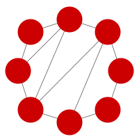
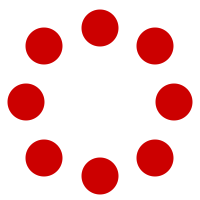

::: {.home-hero}

  
  

<!---
{.hero-logo}
[LEARN · EXPERIMENT · UNDERSTAND]{.hero-eyebrow}
--->

# SDM Lab Book {.hero-title}

::: {.hero-subtitle}
Computational Notebooks for the Minining of Social Data Labs
:::

::: {.hero-actions}
[Getting started](getting-started.qmd){.btn .btn-primary .btn-lg}
[Explore the labs](labs/index.qmd){.btn .btn-outline-primary .btn-lg}
:::

:::

::: {.home-features}
::: {.home-feature}
### Setup environment

Prepare your environment and open your first notebook with the
[getting started guide](getting-started.html).
:::

::: {.home-feature}
### Learning by doing

Follow the [labs](labs/index.html), code up your solution and answer the
questions using `Python` and `Markdown`.
:::
